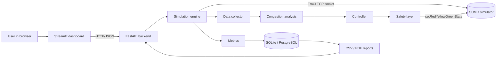
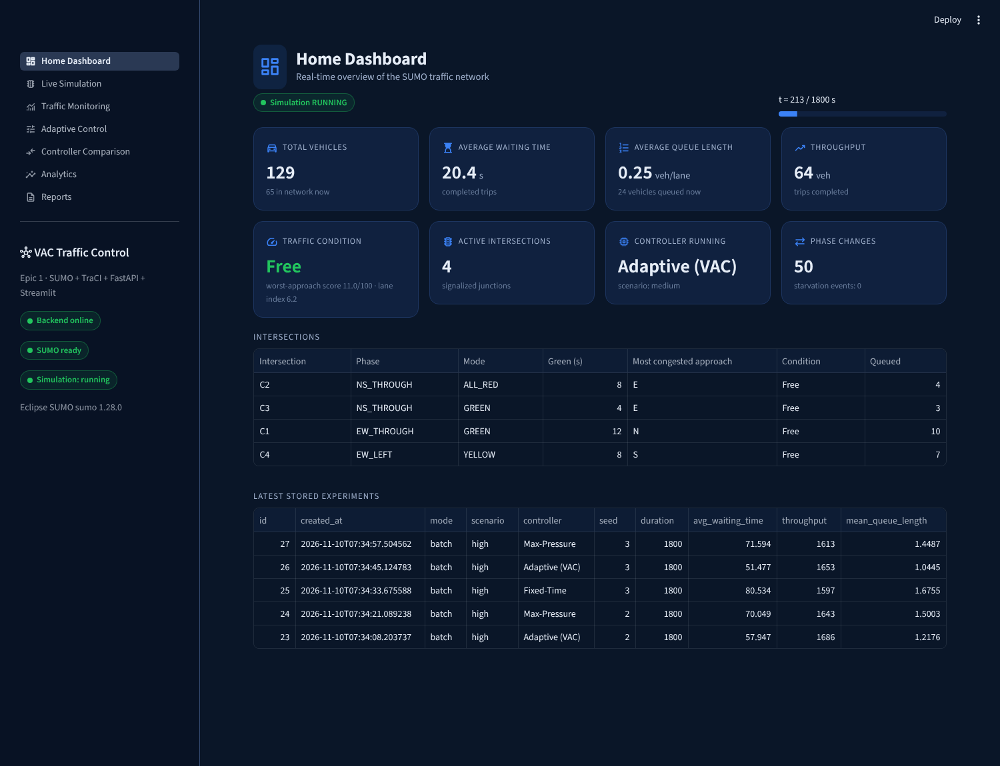
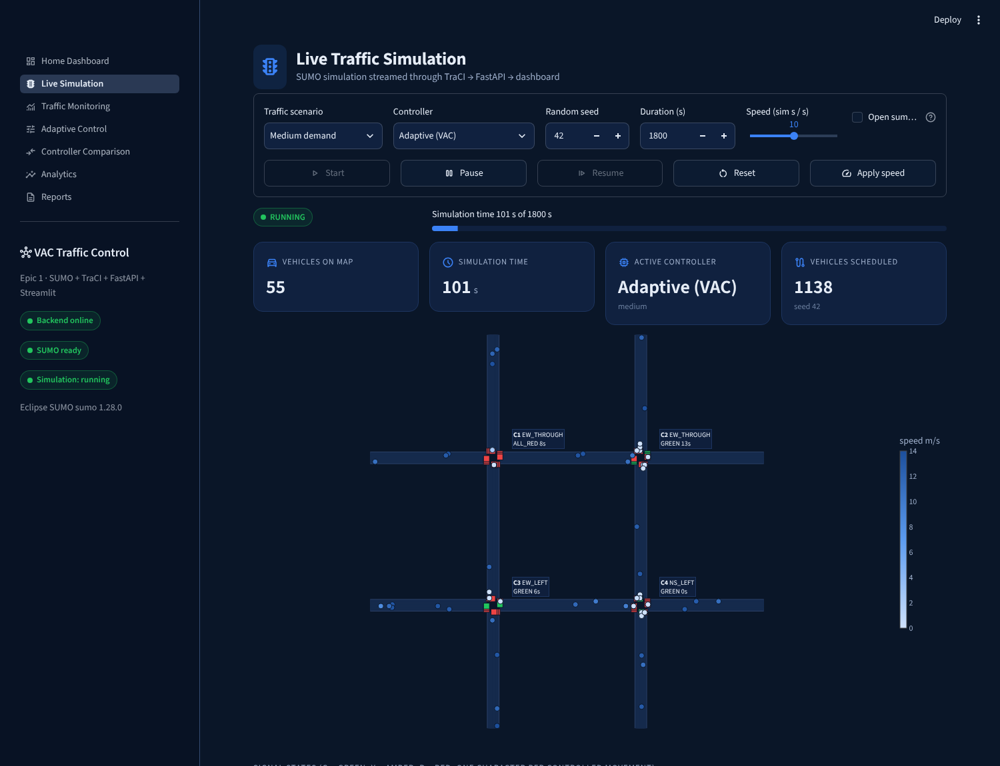
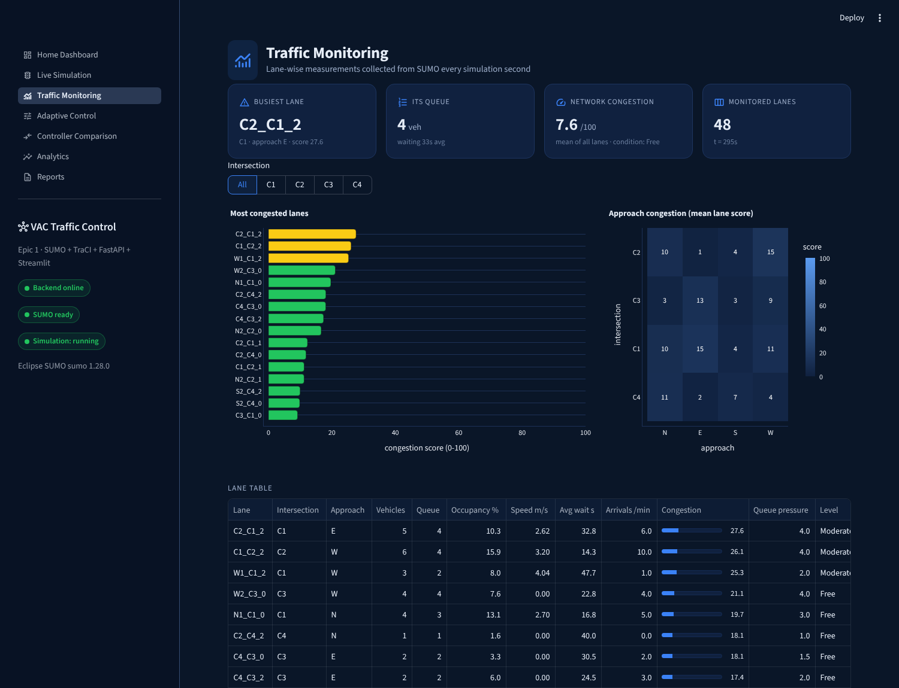
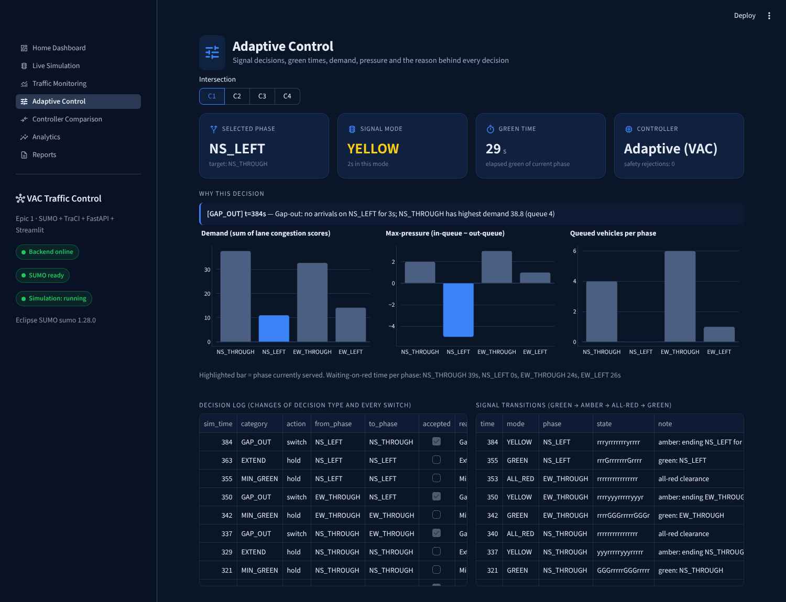
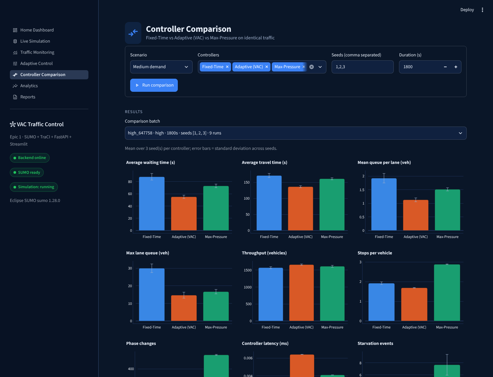
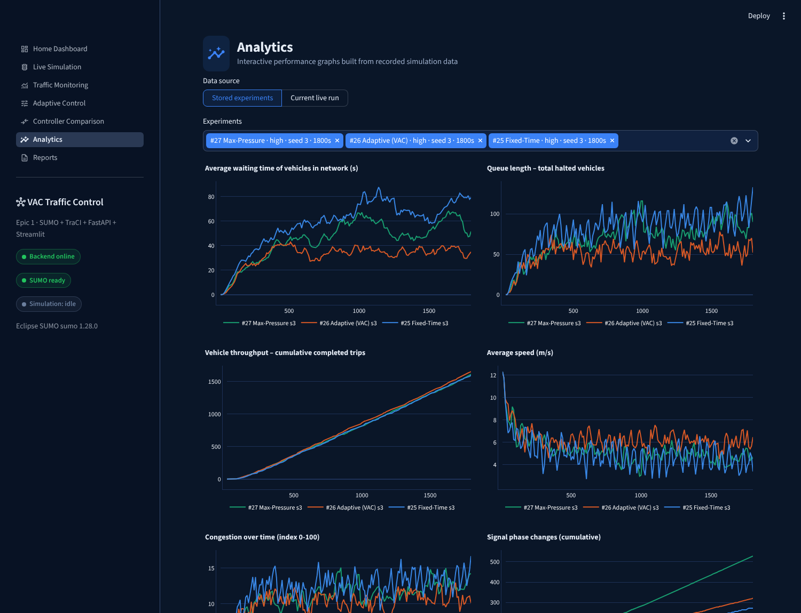
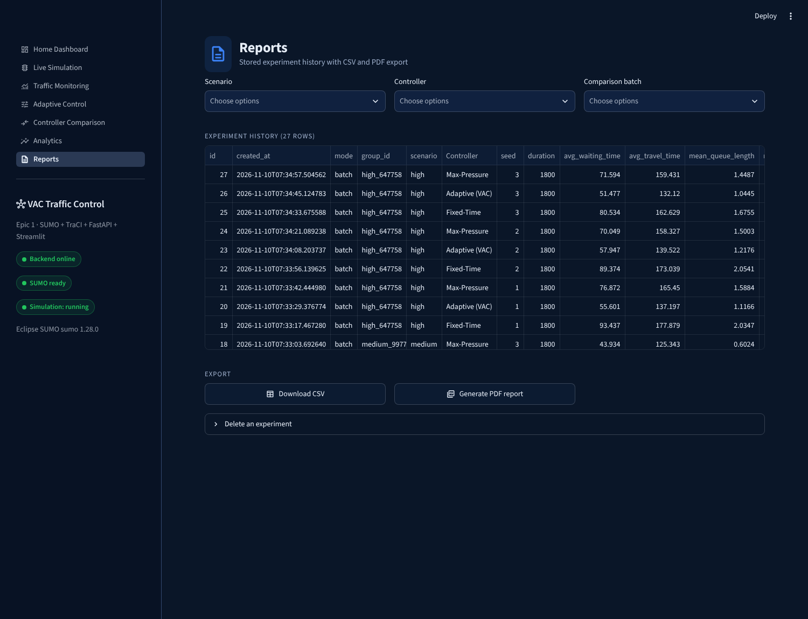
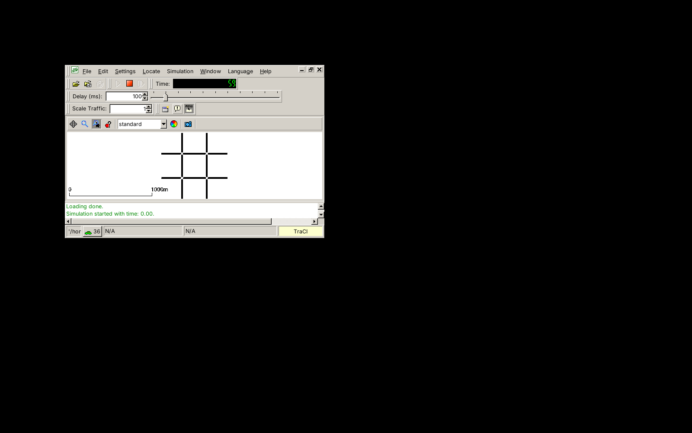

# Project Documentation – VAC-Inspired Adaptive Traffic Control System

*Epic 1 of "Quantum-AI Enabled Digital Twin for Real-Time Smart Traffic Optimization"*

This document explains the whole project in simple language so that a student can understand it
and present it. Every number in the Results section was measured by running the software. No
value was invented.

---

## 1. Project title and objectives

**Title:** VAC-Inspired Adaptive Traffic Control System

**Main objective:** build an application that simulates road traffic, monitors vehicle demand, and
automatically adjusts traffic-signal timings to reduce congestion and waiting time.

**Specific objectives**
1. Build a realistic simulated road network with **four connected signalized intersections**.
2. Collect live traffic data (vehicle count, queue, occupancy, speed, waiting time, arrival rate,
   signal phase, green time) every simulated second.
3. Measure congestion with an **explainable, configurable** score.
4. Implement three signal controllers: **Adaptive (VAC)**, **Max-Pressure** and **Fixed-Time**.
5. Guarantee **safety**: minimum green, amber, all-red, no conflicting greens, no starvation.
6. Provide a professional **web dashboard** and a **REST API**.
7. Compare the controllers **fairly**, store the results and generate **CSV/PDF reports**.

---

## 2. Problem statement

Most city junctions still use signals that repeat the same timing all day. When traffic on one
road is heavy and another road is empty, the empty road still gets its full green while the busy
road waits. The result is long queues, wasted fuel, more emissions and frustrated drivers.

We need signals that **look at the actual traffic** and decide **which road gets green and for how
long**, while never compromising safety.

---

## 3. Existing system

| Type | How it works | Example |
|---|---|---|
| **Fixed-time (pre-timed)** | A fixed cycle such as 30 s N–S, 12 s left turns, 30 s E–W, … repeated forever | Most junctions in Indian cities |
| **Time-of-day plans** | Several fixed plans switched by the clock (morning peak, off-peak) | Larger cities |
| **Manual control** | A traffic police officer overrides the signal | Busy junctions at peak hour |
| **Commercial adaptive systems** | Centralised optimisation using detectors (SCOOT, SCATS) | A few large cities; expensive |

## 4. Limitations of existing approaches

* **Fixed-time** ignores real demand. Green is wasted on empty approaches, and queues grow on busy ones.
* **Time-of-day plans** follow the clock, not the traffic. A festival, an accident or rain breaks them.
* **Manual control** depends on one person, cannot coordinate many junctions, and is tiring.
* **Commercial adaptive systems** are expensive and proprietary, so they are hard to study or modify.
* Most real deployments cannot be **tested safely before installation**. A simulation
  ("digital twin") lets us test controllers without risk.

## 5. Proposed system

A **simulation-based adaptive traffic control system**:

* **SUMO** simulates every vehicle on a 2 × 2 grid of signalized intersections.
* A Python backend reads the traffic through **TraCI** every second and computes a
  **congestion score** for every lane.
* A controller decides the next signal phase. The default is the **VAC-inspired adaptive** controller.
  It **extends** green while vehicles keep arriving, **ends** it when the flow stops (gap-out) or
  at a maximum (max-out), and then gives green to the **most congested** waiting movement.
  A **starvation guard** makes sure a low-demand road is never forgotten.
* A separate **safety layer** checks every signal state before it reaches SUMO. It enforces
  minimum green, 3 s amber, 2 s all-red and a conflict matrix.
* **Max-Pressure** and **Fixed-Time** run on exactly the same traffic for comparison.
* **FastAPI** exposes everything as an API. **Streamlit** shows it in a dark smart-city dashboard.
  **SQLite** stores every experiment. Reports are exported as CSV and PDF.

**Advantages:** it reacts to real demand, it explains every decision, it is safe by construction,
the comparison is reproducible, and it is open and extensible (Epic 2 can plug in an optimiser).

---

## 6. Complete project workflow



**Each simulated second:**
1. SUMO moves all vehicles one step (`simulationStep`).
2. The safety layer advances amber / all-red timers.
3. The collector reads all lane and vehicle data in one TraCI message (subscriptions).
4. The analysis module computes lane congestion scores, queue pressure, phase demand and phase pressure.
5. For every intersection that is showing green, the controller makes a decision with a reason.
   Its computation time is measured.
6. The safety layer validates the decision and, if it is allowed, starts amber → all-red → new green.
7. The metrics tracker updates waiting times, stops, queues, throughput and starvation counters.

When a run ends, its summary, time series and decision log are written to the database.

---

## 7. Explanation of every module

| # | Module (folder) | What it does |
|---|---|---|
| 1 | **SUMO traffic simulation** (`backend/sumo_config`, `backend/simulation`) | `build_network.py` writes nodes, edges and explicit lane connections and calls **netconvert** to create `grid4.net.xml`. That network has 4 traffic-light junctions (C1–C4), 3 lanes per direction (lane 0 right + straight, lane 1 straight, lane 2 left only) and 8 boundary entries. `generate_routes.py` creates seeded Poisson demand for the low, medium and high scenarios with a car/truck/bus mix. `engine.py` runs one simulation step by step. `live_session.py` adds start, pause, resume and reset in a background thread. |
| 2 | **Traffic data collection** (`backend/data_collection`) | `traffic_state.py` defines the standard data structures (`LaneState`, `SignalState`, `IntersectionState`, `NetworkState`), with validation of missing or invalid values. `collector.py` subscribes to 6 variables on every lane and 6 on every vehicle, and produces all required measurements every second. |
| 3 | **Demand & congestion analysis** (`backend/analysis/congestion.py`) | Computes the lane congestion score (0–100), queue pressure, phase demand, phase pressure, the most congested approach, the priority phase and a congestion level (Free / Moderate / Heavy / Severe). |
| 4 | **Adaptive controller** (`backend/controllers/adaptive.py`) | Applies the VAC rules: min green → starvation guard → max-out → extension → gap-out → rest. Every decision includes a readable reason. |
| 5 | **Max-Pressure controller** (`backend/controllers/max_pressure.py`) | Picks the phase with the highest pressure, with min/max green and hysteresis. |
| 6 | **Fixed-Time controller** (`backend/controllers/fixed_time.py`) | Uses a fixed cycle: NS_THROUGH 30 s → NS_LEFT 12 s → EW_THROUGH 30 s → EW_LEFT 12 s. |
| – | **Safety layer** (`backend/controllers/safety.py`) | Shared by all controllers. It enforces minimum green, amber and all-red, checks the conflict matrix and validates every state, so an invalid state is never sent to SUMO. |
| 7 | **Web dashboard** (`frontend/`) | Seven Streamlit pages that call the API only: Home, Live Simulation, Traffic Monitoring, Adaptive Control, Controller Comparison, Analytics, Reports. |
| 8 | **Performance evaluation** (`backend/evaluation`) | `metrics.py` measures all 8 required metrics. `experiment.py` runs fair repeated comparisons (same network, demand, duration and seed) and aggregates mean ± standard deviation and % change versus Fixed-Time. |
| 9 | **Error handling & validation** (throughout) | SUMO-not-found and connection errors give readable messages. Lane data is cleaned. The safety layer rejects invalid transitions. The API validates inputs (HTTP 422) and states (409/404). Loss of the SUMO process is handled. The dashboard shows an "offline" status. No dummy data is shown: pages say "no data yet" instead. |
| 10 | **Documentation** (`docs/`, `HOW_TO_RUN.md`) | The files you are reading. |

---

## 8. Role of every technology

| Technology | Role in this project |
|---|---|
| **Python** | All backend logic, controllers, analysis, tests, scripts |
| **SUMO** | Microscopic traffic simulator: moves every vehicle and shows the signals (headless `sumo`, or `sumo-gui`) |
| **netconvert** (part of SUMO) | Builds the road network file from our node, edge and connection definitions |
| **TraCI** | The protocol and Python library used to read traffic data from SUMO and set signal states |
| **sumolib** | Reads the network file (lanes, lengths, shapes, signal links) to build the network model |
| **FastAPI** | REST backend: the only component that talks to SUMO; serves state, controls, experiments and reports |
| **Uvicorn** | The web server that runs the FastAPI application |
| **Pydantic** | Validates API requests (scenario, controller, duration limits and so on) |
| **Streamlit** | The dashboard user interface |
| **Requests** | HTTP client the dashboard uses to call the API |
| **Plotly** | Interactive charts and the live network map in the dashboard |
| **Pandas / NumPy** | Tables, aggregation, means, standard deviations and percentiles |
| **SQLAlchemy + SQLite** | Experiment storage; the same code works on PostgreSQL by changing `DATABASE_URL` |
| **Matplotlib** | Charts and tables inside the PDF report |
| **pytest / httpx** | Automated unit, integration and API tests |

Scikit-learn and PyTorch were **not** used, because Epic 1 needs no prediction model. The
controllers are reactive and rule-based, which keeps them explainable. Adding unused libraries
would break the "every technology has a purpose" rule.

---

## 9. How SUMO and TraCI communicate

1. The backend writes a small `run.sumocfg` (network file + generated route file + duration).
2. `traci.start([...sumo, "-c", "run.sumocfg", "--seed", ...], label=...)` launches SUMO as a
   separate process. SUMO opens a **TCP socket** and Python connects to it.
3. SUMO now **waits for commands**. Each `conn.simulationStep()` advances exactly 1 second.
4. **Reading data:** the backend subscribes once to the lane variables it needs (vehicle number,
   halting number, occupancy, mean speed, waiting time, vehicle IDs) and to vehicle variables
   (speed, lane, position, angle, type). After each step, **one** call
   (`getAllSubscriptionResults`) returns all of it. That is much faster than hundreds of separate queries.
5. **Writing signals:** the safety layer calls
   `conn.trafficlight.setRedYellowGreenState("C1", "GGGrrrrrGGGrrrrr")`. There is one character per
   controlled movement: `G` green, `y` amber, `r` red. This replaces SUMO's built-in program, so
   *our* controller is fully in charge.
6. When the run ends, `conn.close()` stops SUMO. Each run uses its own **label**, so a live run and a
   comparison job can run at the same time.

## 10. How FastAPI and Streamlit interact

* Streamlit **never** imports SUMO or the controllers. It only sends HTTP requests to FastAPI
  (`frontend/api_client.py`).
* Example: pressing **Start** sends `POST /simulation/start {"scenario":"high","controller":"adaptive",...}`.
  FastAPI starts SUMO in a background thread and returns immediately.
* The Live page refreshes every second with `@st.fragment(run_every=1)`. Each refresh calls
  `GET /simulation/snapshot` (vehicle positions + signal strings) and `GET /simulation/status`.
* Monitoring and Adaptive Control call `GET /simulation/state` and `GET /simulation/decisions`.
* Comparison calls `POST /experiments/compare` and polls `GET /experiments/jobs/{id}`.
* Reports downloads `GET /reports/csv` and `GET /reports/pdf`.
* If the backend is down, the client raises a clear message and the sidebar shows "Backend offline".

This separation means another frontend, or Epic 2's optimiser, can use the same API.

## 11. Traffic data collection process

For each of the **48 approach lanes** (4 junctions × 4 approaches × 3 lanes), every second:

| Measurement | Source |
|---|---|
| Vehicle count | `LAST_STEP_VEHICLE_NUMBER` |
| Queue length | `LAST_STEP_VEHICLE_HALTING_NUMBER` (vehicles below 0.1 m/s) |
| Occupancy % | `LAST_STEP_OCCUPANCY` × 100 (TraCI returns a fraction) |
| Average speed | `LAST_STEP_MEAN_SPEED` |
| Average waiting time | `VAR_WAITING_TIME` (sum on lane) ÷ vehicle count |
| Arrival rate | New vehicle IDs entering the lane, counted over a 60 s sliding window → vehicles/min |
| Vehicles in detector zone | Vehicles within 40 m of the stop line (from vehicle lane positions) |
| Current phase, elapsed green, mode | From the safety layer, which owns the real signal |

Outgoing lanes are also read, because Max-Pressure needs their queues. All values pass through
`LaneState.validate()`: missing, NaN or negative values become 0, queue is capped at vehicle count,
and occupancy is capped at 100.

## 12. Congestion calculation method

```
capacity = lane length / 7.5 m                       (how many cars fit)
score = 100 × ( 0.40 × min(queue / capacity, 1)
              + 0.20 × occupancy / 100
              + 0.25 × min(average wait / 60 s, 1)
              + 0.15 × min(arrival rate / 12 per min, 1) )
```
* Level: < 25 **Free**, < 50 **Moderate**, < 75 **Heavy**, otherwise **Severe**.
* **Queue pressure** of a lane = its queue − the average queue on the lanes it feeds.
* **Phase demand** = the sum of the scores of the lanes the phase serves.
* **Most congested approach** = the approach (N/E/S/W) with the highest mean lane score.
* All weights and normalisers are in `backend/config.py`, so they are easy to change and to explain.

## 13. Adaptive signal control algorithm (VAC-inspired)

VAC = **Vehicle-Actuated Control**: the green time depends on detected vehicles. The rules are
checked in this order every second while a phase is green:

1. **Minimum green (8 s)** – never cut a green shorter than this.
2. **Starvation guard** – if a waiting phase's vehicles have been on red for ≥ 90 s, serve it now.
3. **Max-out (50 s)** – if the green reached 50 s and someone else is waiting, end it and serve the
   phase with the highest demand.
4. **Extension** – if a vehicle was in the 40 m detector zone in the last 3 s (the passage time),
   keep the green.
5. **Gap-out** – if no vehicle arrived for 3 s, end the green and serve the highest-demand phase.
6. **Rest** – if nobody else is waiting, stay green.

Example reason shown on the dashboard:
`Gap-out: no arrivals on NS_THROUGH for 3s; NS_LEFT has highest demand 47.6 (queue 7)`.

## 14. Max-Pressure algorithm

```
pressure(phase) = Σ over its movements ( incoming lane queue ÷ movements sharing that lane
                                        − outgoing lane queue )
```
After the 8 s minimum green, the controller switches to the phase with the highest pressure if it
beats the current phase by more than 1 vehicle (hysteresis). A 50 s max green caps any phase when
others are waiting. The idea comes from Varaiya (2013): serving the biggest imbalance keeps the
network stable. It does **not** have a starvation guard, and the results show this.

## 15. Fixed-Time controller

A cycle of NS_THROUGH 30 s → NS_LEFT 12 s → EW_THROUGH 30 s → EW_LEFT 12 s, plus 5 s of
amber + all-red after each phase. The cycle length is 104 s. It ignores traffic completely and is
the **baseline**.

## 16. Safety constraints

All controllers go through the same `SignalExecutor`:

| Rule | How it is enforced |
|---|---|
| Minimum green | A switch request before 5 s (safety level) is refused. Controllers also apply their own 8 s minimum. |
| Maximum green | 50 s in Adaptive and Max-Pressure (fixed plan for Fixed-Time) |
| Amber | Every green movement shows `y` for 3 s before it can turn red |
| All-red | 2 s with every movement red before any new green |
| No conflicting movements | A conflict matrix is computed from geometry. A state with two conflicting greens raises `SafetyViolation` and is not sent |
| Valid transitions | Green → red without amber is rejected. Green while a conflicting movement is amber is rejected |
| No starvation | Adaptive starvation guard (90 s). Starvation events are also counted for every controller (120 s threshold) |

The integration tests read the signal state back from SUMO **every second** and re-validate it.
Over all runs: **0 safety violations**.

The **conflict matrix**: each movement is drawn as a line from its entry point to its exit point
inside the junction box (right-hand traffic). Two movements conflict if the lines cross or if they
leave on the same road (a merge). The 4 phases (NS_THROUGH, NS_LEFT, EW_THROUGH, EW_LEFT) were
verified to be conflict-free, and every movement gets green in some phase.

## 17. Database operations

SQLAlchemy Core with four tables (details in [DATABASE_SCHEMA.md](DATABASE_SCHEMA.md)):
`experiments` (settings), `results` (one summary row), `timeseries` (every 10 s) and `decisions`
(every switch, plus changes of decision type). The operations are **insert** at the end of every
run, **list/filter** for history, **get** for one experiment and its series, **delete**, and
**aggregate** per comparison batch. SQLite is used by default (`data/vac_traffic.db`). Setting
`DATABASE_URL` to a PostgreSQL URL uses PostgreSQL with no code change.

## 18. Performance evaluation

Measured for every run:

1. **Average waiting time**: time a vehicle spends below 0.1 m/s, averaged over completed trips
2. **Mean and maximum queue length**: mean halted vehicles per approach lane, and the largest single-lane queue
3. **Vehicle throughput**: trips completed
4. **Average travel time**: arrival − departure
5. **Stops per vehicle**: moving → halted transitions
6. **Number of phase changes**
7. **Controller computation latency**: wall-clock time of each `decide()` call (mean, p95, max)
8. **Starvation events**: a phase whose vehicles wait on red ≥ 120 s, counted once per episode

**Fairness:** for a given seed, every controller gets the **byte-identical route file**, the same
network, the same duration and the same SUMO `--seed`. A test checks this. Repeating with several
seeds gives the mean ± standard deviation.

## 19. Results with actual experimental values

Run on 10 Nov 2026 with SUMO 1.28.0. Command:
`python scripts/run_experiments.py --scenarios low medium high --seeds 1 2 3 --duration 1800`.
Values are the mean ± standard deviation over the 3 seeds. Full table:
[results/experiment_results.md](results/experiment_results.md). Raw data:
[results/experiment_results.json](results/experiment_results.json),
[results/experiments_all.csv](results/experiments_all.csv).

**High demand (450 veh/h per entry, 1800 s)**

| Metric | Fixed-Time | Adaptive (VAC) | Max-Pressure |
|---|---|---|---|
| Average waiting time (s) | 87.78 ± 5.39 | **55.01 ± 2.67** | 72.84 ± 2.92 |
| Average travel time (s) | 171.18 ± 6.36 | **136.28 ± 3.09** | 161.07 ± 3.13 |
| Mean queue per lane (veh) | 1.92 ± 0.17 | **1.13 ± 0.07** | 1.51 ± 0.06 |
| Max lane queue (veh) | 30.00 ± 2.45 | **14.67 ± 1.70** | 16.67 ± 1.25 |
| Throughput (vehicles) | 1568.67 ± 28.89 | **1659.67 ± 19.36** | 1610.00 ± 28.25 |
| Stops per vehicle | 1.92 ± 0.07 | **1.69 ± 0.01** | 2.88 ± 0.02 |
| Phase changes | 272 | 311.67 ± 7.36 | 530.67 ± 4.50 |
| Controller latency (ms) | 0.0032 | 0.0064 | 0.0041 |
| Starvation events | 0 | 0 | 7.67 ± 1.70 |

**Average waiting time across scenarios (s)**

| Scenario | Fixed-Time | Adaptive (VAC) | Max-Pressure |
|---|---|---|---|
| Low | 50.34 ± 1.90 | **21.85 ± 1.84** (−56.6 %) | 33.16 ± 0.14 (−34.1 %) |
| Medium | 61.55 ± 3.42 | **36.42 ± 0.57** (−40.8 %) | 41.73 ± 1.79 (−32.2 %) |
| High | 87.78 ± 5.39 | **55.01 ± 2.67** (−37.3 %) | 72.84 ± 2.92 (−17.0 %) |

**What the data shows**
* The adaptive controller had the lowest waiting time, travel time and mean queue in **all three
  scenarios and all 9 scenario-seed combinations**. The gaps are much larger than the
  seed-to-seed standard deviation.
* Throughput differences are small at low and medium demand (+0.9 to +2 %). Most vehicles finish
  either way. At high demand the adaptive controller completed about **+5.8 %** more trips.
* Max-Pressure reduced waiting time compared with Fixed-Time, but it switched far more often. It
  also had **more stops per vehicle** than Fixed-Time (+20 % to +50 %) and some starvation events,
  because it has no starvation guard.
* All controllers decide in **well under 0.01 ms** per intersection, so computation is not a
  bottleneck.
* No teleports (gridlock removals) happened in any of the 27 runs.

**Honest caveat:** the improvement is relative to *this* fixed-time plan (30/12/30/12 s), which was
chosen by hand and not optimised for each demand level. A Webster-optimised plan would narrow the gap.

## 20. Limitations

* Simulation only. Real detectors are noisy and real drivers differ from SUMO's model.
* The detector zone uses exact vehicle positions from SUMO (an idealised loop detector).
* Each intersection is controlled independently; there is no green-wave coordination between C1–C4.
* Synthetic Poisson demand with uniform destinations, not calibrated real counts.
* No pedestrians, emergency-vehicle priority or public-transport priority.
* The fixed-time baseline is not optimised (see the caveat above).
* Live mode keeps one live simulation at a time. Comparison jobs run one batch at a time.
* The dashboard map is a simplified 2-D Plotly view. Tick "Open sumo-gui" for SUMO's full graphics.
* sumo-gui needs a desktop display (on macOS it also needs XQuartz).
* PostgreSQL support was verified (51/51 tests, identical results); SQLite is the default.

## 21. Future enhancements

* **Epic 2:** formulate phase selection across all junctions as a QUBO and solve it with
  quantum or annealing optimisers. The API and controller interface are ready for a new controller class.
* Demand prediction (scikit-learn or PyTorch) for proactive control.
* Coordination and offsets between neighbouring junctions (green waves).
* A Webster-optimised fixed-time baseline, and actuated-coordinated baselines.
* Real network import from OpenStreetMap (`netconvert --osm`) and calibration with real counts.
* Emergency-vehicle and bus priority, and pedestrian phases.
* Authentication and multi-user sessions; Docker deployment; PostgreSQL in production.

## 22. Screenshots and diagrams

All screenshots were taken from the running application (Chrome, 1500 px wide).

| Page | Screenshot |
|---|---|
| Home dashboard |  |
| Live simulation |  |
| Traffic monitoring |  |
| Adaptive control |  |
| Controller comparison |  |
| Analytics |  |
| Reports |  |
| sumo-gui driven by TraCI (virtual display) |  |

Architecture diagrams are in [SYSTEM_ARCHITECTURE.md](SYSTEM_ARCHITECTURE.md).

## 23. Likely viva questions (short answers)

* **Why SUMO?** It is open-source, microscopic (models each vehicle) and controllable live through TraCI.
* **Why not let SUMO's own actuated signals run?** We need our own logic, reasons, safety checks and
  fair comparison, so we override the signal state every step.
* **How do you know the comparison is fair?** Same route file (byte-identical, tested), same seed,
  network and duration. Only the controller changes. Three seeds give mean ± std.
* **How is safety guaranteed?** Controllers can only *request*. The safety layer validates every
  state against the conflict matrix and the amber/all-red rules before SUMO sees it, and the tests
  verify it every second.
* **Why is Max-Pressure worse than Adaptive here?** It switches very often (about 530 changes vs 312
  at high demand). Each switch costs 5 s of amber and all-red, and it has no starvation guard.
  This is a measured result for this network, not a general rule.
