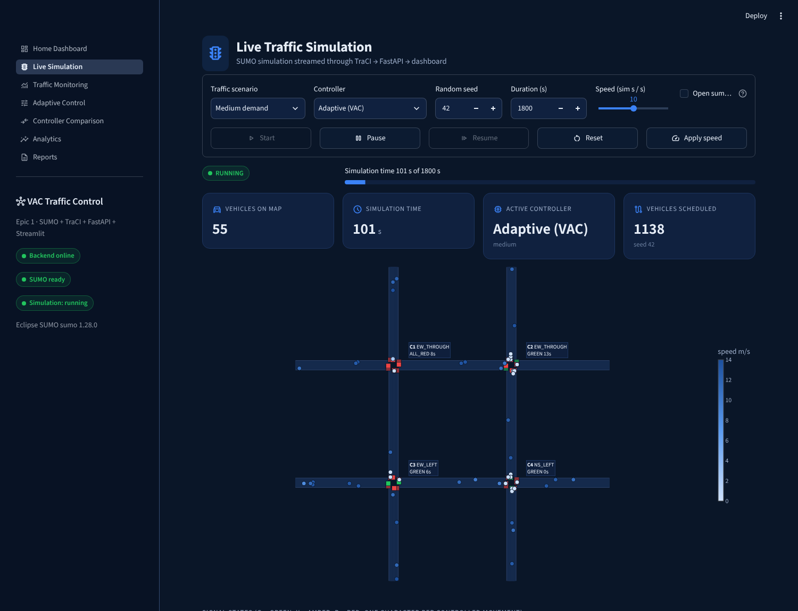

# VAC-Inspired Adaptive Traffic Control System

**Epic 1 of "Quantum-AI Enabled Digital Twin for Real-Time Smart Traffic Optimization"**

A working smart-traffic application. It simulates a 4-intersection road network in **SUMO**,
reads live traffic data through **TraCI**, and changes the traffic signals automatically with
three interchangeable controllers:

* **Adaptive (VAC – Vehicle-Actuated Control)** – extends or ends green based on detected vehicles,
  picks the most congested phase next, and has a starvation guard.
* **Max-Pressure** – serves the phase with the largest (incoming − outgoing) queue difference.
* **Fixed-Time** – a conventional fixed cycle, used as the baseline.

A **FastAPI** backend owns the simulation. A **Streamlit** dashboard (7 pages) shows everything
live, compares controllers fairly, stores results in **SQLite** (PostgreSQL-compatible) and
exports **CSV** and **PDF** reports.

> Epic 1 only. There is no quantum computing, QUBO, vehicle routing or computer vision here.



## Quick start

See **[HOW_TO_RUN.md](../HOW_TO_RUN.md)** for the full beginner guide. In short:

```bash
python -m venv .venv
.venv\Scripts\activate            # Windows   (macOS/Linux: source .venv/bin/activate)
pip install -r requirements.txt
python scripts/check_environment.py
# terminal 1
python -m uvicorn backend.main:app --host 127.0.0.1 --port 8000
# terminal 2
python -m streamlit run frontend/app.py --server.port 8501
```
Then open http://localhost:8501.

## Measured results (summary)

These come from 27 runs: 3 scenarios × 3 seeds × 3 controllers, 1800 s each, on identical demand.
They were produced with `python scripts/run_experiments.py` on SUMO 1.28.0. The full tables are in
[results/experiment_results.md](results/experiment_results.md).

| Scenario | Avg waiting (s): Fixed-Time | Adaptive (VAC) | Max-Pressure |
|---|---|---|---|
| Low (150 veh/h per entry) | 50.34 | **21.85** (−56.6 %) | 33.16 (−34.1 %) |
| Medium (300 veh/h per entry) | 61.55 | **36.42** (−40.8 %) | 41.73 (−32.2 %) |
| High (450 veh/h per entry) | 87.78 | **55.01** (−37.3 %) | 72.84 (−17.0 %) |

In these runs the adaptive controller had the lowest waiting time, travel time and mean queue in
every scenario, and zero starvation events. Max-Pressure also beat the baseline on waiting time,
but caused more stops per vehicle and some starvation events (it has no starvation guard). These
findings hold **for this network, this demand model and this fixed-time plan**. The fixed-time plan
was not optimised with Webster's method; see the limitations in
[PROJECT_DOCUMENTATION.md](PROJECT_DOCUMENTATION.md#20-limitations).

## Documentation index

| File | Contents |
|---|---|
| [HOW_TO_RUN.md](../HOW_TO_RUN.md) | What to install, which command, in which terminal, and error fixes |
| [PROJECT_DOCUMENTATION.md](PROJECT_DOCUMENTATION.md) | The full project explanation for presentation to faculty |
| [SYSTEM_ARCHITECTURE.md](SYSTEM_ARCHITECTURE.md) | Components, data flow, folder structure, threading |
| [TECH_STACK.md](TECH_STACK.md) | Every technology and exactly why it is used |
| [ALGORITHMS.md](ALGORITHMS.md) | Congestion score, VAC, Max-Pressure, Fixed-Time, safety rules, metrics |
| [API_DOCUMENTATION.md](API_DOCUMENTATION.md) | All REST endpoints with examples |
| [DATABASE_SCHEMA.md](DATABASE_SCHEMA.md) | Tables, columns, PostgreSQL switch |
| [TESTING_REPORT.md](TESTING_REPORT.md) | What was tested, how, and the results |
| [USER_GUIDE.md](USER_GUIDE.md) | How to use each dashboard page |
| [results/](results/) | Measured experiment results (MD/JSON/CSV) and a sample PDF report |
| [screenshots/](screenshots/) | Real screenshots of every page |

## Project structure

```
vac_traffic_epic1/
├── backend/
│   ├── main.py                  FastAPI app (all endpoints)
│   ├── config.py                every tunable parameter
│   ├── sumo_config/             network builder, demand generator, generated .net.xml
│   ├── simulation/              TraCI start-up, network model + conflict matrix, engine, live session
│   ├── data_collection/         traffic-state data structures + TraCI collector
│   ├── analysis/                congestion score, queue pressure, priority
│   ├── controllers/             safety layer, fixed-time, adaptive (VAC), max-pressure
│   ├── evaluation/              metrics tracker, fair experiment runner
│   ├── database/                SQLAlchemy tables and queries
│   └── reports/                 CSV + PDF generation
├── frontend/                    Streamlit app, API client, theme, 7 pages in views/
├── tests/                       51 pytest tests (unit + real-SUMO integration + API)
├── scripts/                     check_environment.py, run_experiments.py
├── docs/                        this documentation, results, screenshots
├── data/                        SQLite database + per-run generated route files
├── requirements.txt
└── HOW_TO_RUN.md
```

## Testing

```bash
python -m pytest -v
```
51 tests, all passing (see [TESTING_REPORT.md](TESTING_REPORT.md)).
