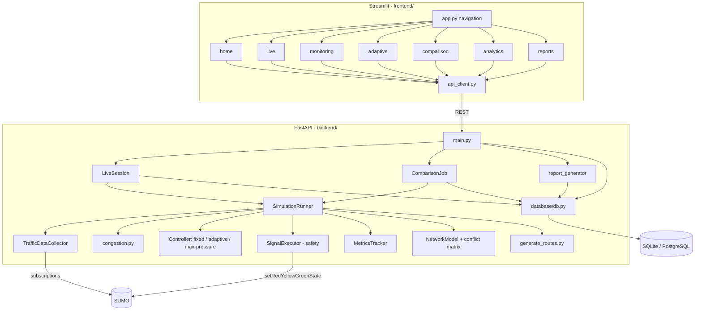
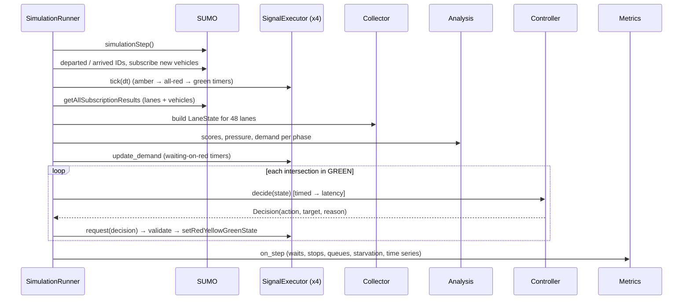

# System Architecture

## 1. Layered view

```
┌──────────────────────────────────────────────────────────────────────┐
│  PRESENTATION   Streamlit dashboard (frontend/)                       │
│  7 pages · Plotly charts · polls the API every 1–2 s                  │
└───────────────────────────────▲──────────────────────────────────────┘
                                │ HTTP / JSON  (frontend/api_client.py)
┌───────────────────────────────┴──────────────────────────────────────┐
│  API            FastAPI (backend/main.py) · Pydantic validation       │
│  /simulation/*  /experiments/*  /reports/*  /network  /health         │
├──────────────────────────────────────────────────────────────────────┤
│  APPLICATION    LiveSession (thread)      ComparisonJob (thread)      │
│                 └──────────── SimulationRunner (engine.py) ───────────│
│                   collector → analysis → controller → safety layer    │
│                   → metrics                                           │
├──────────────────────────────────────────────────────────────────────┤
│  DATA           SQLAlchemy (SQLite / PostgreSQL) · CSV/PDF reports    │
└───────────────────────────────▲──────────────────────────────────────┘
                                │ TraCI over TCP (one connection per run, labelled)
┌───────────────────────────────┴──────────────────────────────────────┐
│  SIMULATION     SUMO 1.28 (sumo / sumo-gui) · grid4.net.xml           │
│                 + generated demand.rou.xml per run                    │
└──────────────────────────────────────────────────────────────────────┘
```

## 2. Component diagram



## 3. Sequence of one simulation step



## 4. Threading and concurrency

* The FastAPI process holds **one `LiveSession`**. Its simulation runs in a daemon thread. An
  `RLock` protects the runner while API calls read its state. Pause and stop use `threading.Event`s.
  Reset stops the thread *before* taking the lock, which avoids a deadlock.
* A **ComparisonJob** runs its simulations sequentially in another thread. It can run alongside a
  live session because every SUMO process has its own TraCI **label** and connection object.
* SUMO start-up is serialised with a lock, so two runs never race for a port.

## 5. Folder structure and responsibilities

| Path | Responsibility |
|---|---|
| `backend/config.py` | All parameters (scenarios, timings, weights, thresholds, DB URL) |
| `backend/sumo_config/build_network.py` | Writes nodes, edges and connections, then runs netconvert |
| `backend/sumo_config/generate_routes.py` | Seeded demand + `run.sumocfg` per run |
| `backend/simulation/sumo_utils.py` | Find SUMO binaries, start TraCI with clear errors |
| `backend/simulation/network_model.py` | Links, approaches, turns, phases, conflict matrix |
| `backend/simulation/engine.py` | `SimulationRunner`: the step pipeline, state and snapshot views |
| `backend/simulation/live_session.py` | Start, pause, resume, reset and speed for the live run |
| `backend/data_collection/` | Standard data structures + TraCI collector |
| `backend/analysis/congestion.py` | Congestion score, pressure, priority, levels |
| `backend/controllers/` | `safety.py`, `base.py`, `fixed_time.py`, `adaptive.py`, `max_pressure.py` |
| `backend/evaluation/` | `metrics.py` (8 metrics), `experiment.py` (fair comparisons) |
| `backend/database/db.py` | Tables + CRUD with SQLAlchemy |
| `backend/reports/report_generator.py` | CSV + 3-page PDF |
| `backend/main.py` | REST API |
| `frontend/` | `app.py`, `api_client.py`, `theme.py`, `components.py`, `views/*.py` |
| `tests/` | pytest suite |
| `scripts/` | Environment check, batch experiments |
| `data/` | `vac_traffic.db`, `runs/<label>/` (generated per-run files) |

## 6. Road network

* 4 traffic-light junctions C1 (0,300), C2 (300,300), C3 (0,0), C4 (300,0), connected in a 300 m grid.
* 8 boundary nodes (N1, N2, S1, S2, W1, W2, E1, E2) 250 m away. These are the entries and exits.
* 24 directed roads, 3 lanes each, 50 km/h. Lane 0: right + straight; lane 1: straight; lane 2: left only.
* 16 controlled movements per junction and 4 phases: NS_THROUGH, NS_LEFT, EW_THROUGH, EW_LEFT.

## 7. Extension points (for Epic 2)

* Add a controller: subclass `BaseController`, implement `decide()`, and register it in
  `backend/controllers/__init__.py`. It automatically gets safety, metrics, API, dashboard and reports.
* A network-wide optimiser can read `/simulation/state` and its controller can return decisions
  for all four junctions together.
